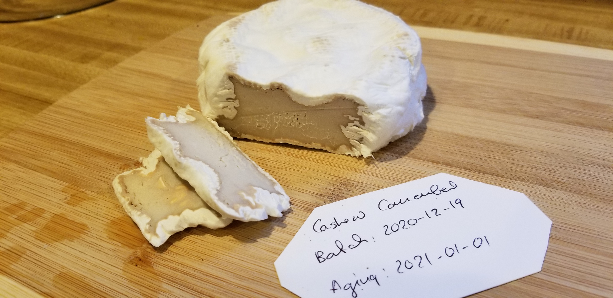
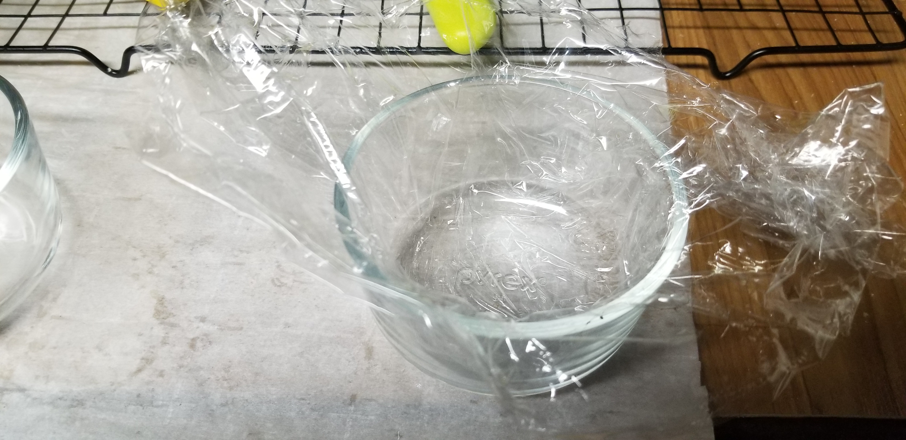
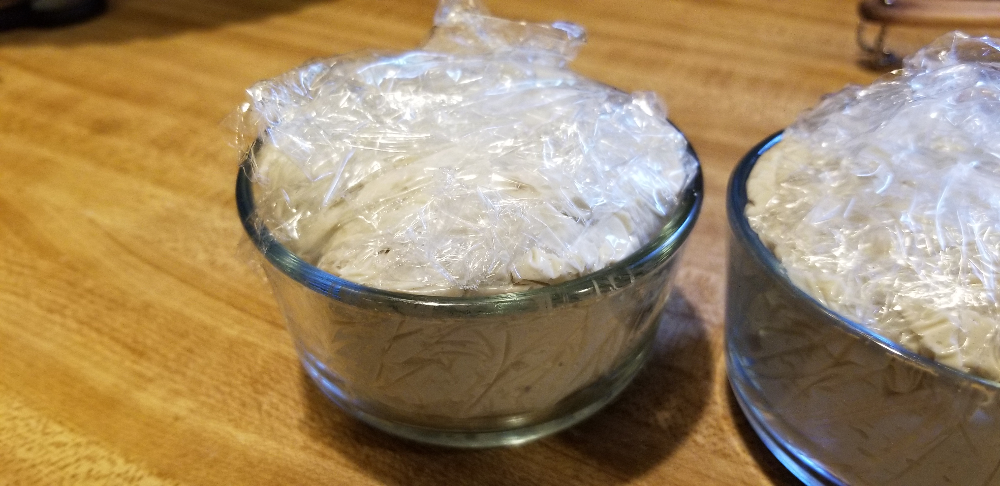
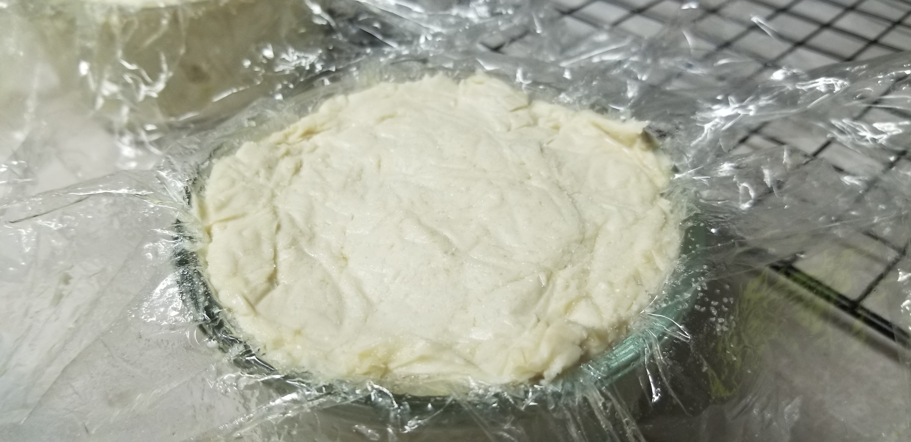
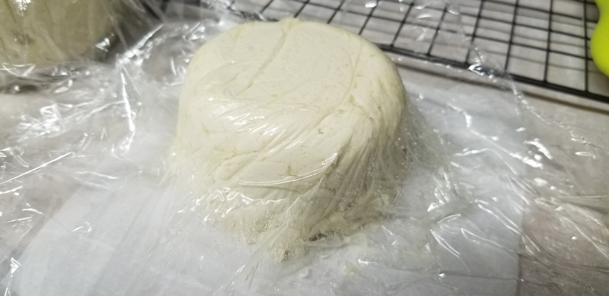
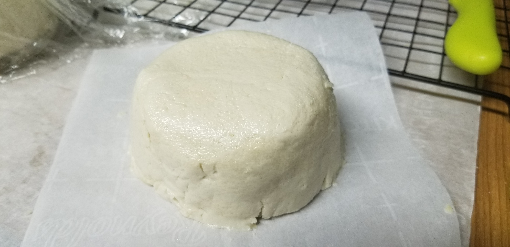
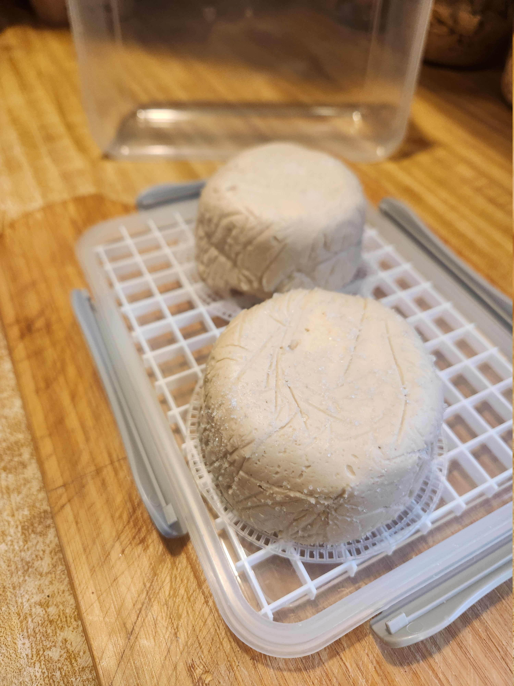
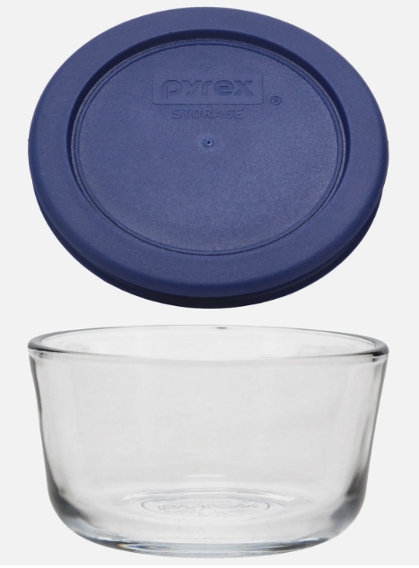
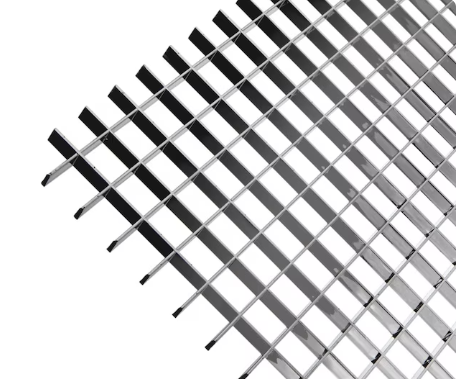

# Vegan Cashew Mold Cheese Base

This base serves as a foundation for various fermented vegan cheeses (Camembert, Blue, etc.) depending on the inoculation used.
The recipe is based on several [notable sources](#credits) 

  

---

## Ingredients

### Cashew Base

* **3 cups (~420 g / 14.8 oz)** Raw cashews
* **10 tbsp (~148 g / 5.2 oz)** Water (start with 6 tbsp / ~89 g / 3.1 oz, add gradually)
* **2 tbsp (~27 g / 1.0 oz)** Coconut oil
* **½ tsp (~3 g / 0.1 oz)** Salt
* **1 tbsp (~17 g / 0.6 oz)** Light sweet miso
* **1 tbsp (~15 g / 0.5 oz)** Fermented tofu (optional)

*⚠️ **Fermented tofu warning:** store-bought fermented tofu can contain preservatives, which may interfere with mold growth. Check the label, or make your own.*

*Weights are approximate (US cups and spoons). Total paste: ~630 g / 22.2 oz.*

### Inoculations (Select one)

* **Standard Tangy:** 6 capsules probiotics **OR** ¼ tsp mesophilic cultures (Type B)
* **Camembert:** ¼ tsp *Geotrichum Candidum* + ¼ tsp *Penicillium Candidum HP 6*
* **Blue Cheese:** ¼ tsp *Penicillium Roqueforti*

---

## Tools

* [High-speed blender](#high-speed-blender)
* [Fermenting heater](#fermenting-heater)
* [Kitchen thermometer](#kitchen-thermometer)
* [Glass containers for molding](#glass-containers-for-molding)
* [Plastic shrink wrap](#plastic-shrink-wrap)
* [Plastic embroidery canvas or parchment paper](#plastic-embroidery-canvas-or-parchment-paper)
* [Ripening containers with internal grids](#ripening-containers-with-internal-grids)
* [Cheese cave](#cheese-cave)
* [Sanitizer/Disinfectant](#sanitizerdisinfectant)

---

## Process

### 1. Preparation & Cleaning

* **Soak & Boil:** Soak cashews for several hours, then boil. Drain well.
* **Sanitize:** Disinfect the blender and all utensils thoroughly.

### 2. Blending

* **Emulsify:** Blend warm cashews with water, coconut oil, salt, miso, and optional fermented tofu until smooth.
* *Note: Cashews must be warm enough to melt the oil but not so hot they break the emulsion.*

* **Inoculate:** Add chosen cultures or flavorings and blend briefly to incorporate.
* *Note: The paste must not be warmer than **35°C (95°F)** when the cultures are added, or the heat can damage them. Let the blended paste cool first if needed. This limit applies only at the moment of inoculation; the paste is then warmed to 105°F–115°F (40°C–46°C) for primary fermentation (see [Fermenting heater](#fermenting-heater)).*

### 3. Primary Fermentation

* **Heat:** Place the blender jar with the paste on a fermenting heater; wrap with towels.
* **Timing:** * **Standard:** 8–24 hours for tang.
    * **Mold-Ripened (Camembert):** 2–4 hours (shorter duration helps prevent black mold).

### 4. Shaping & Setting

* **Homogenize:** Mix the fermented paste to remove any dry surface skin.
* **Mold:** Transfer to glass containers lined with shrink wrap. Fold edges over.

   
  <em>1. Glass container lined with shrink wrap, edges hanging over</em>

   
  <em>2. Containers filled with paste and folded over, ready for the refrigerator</em>

* **Set:** Refrigerate for overnight or at least for several hours until firm.

   
  <em>3. Wheel after refrigeration, ready to be pulled out</em>

### 5. Salting & Initial Aging

* **Unmold:** Pull the wheels by the shrink wrap out of the glass containers. 

   
  <em>4. Wheel pulled out of the container, ready for wrap removal</em>

   
  <em>5. Wheel unwrapped on parchment, ready for salting</em>

* **First Salt:** Unwrap the top and salt the surface. flip onto embroidery canvas/parchment.
* **Second Salt:** Salt the bottom and sides.
* **Cave:** Place on a grid on container cover and install the bottom upside down. Move to the cheese cave.

   
  <em>6. Just-salted wheels on embroidery canvas, resting on the grid on the container lid</em>

### 6. Ripening

* **Daily Flip:** Flip the cheese at least once a day (Days 5–9). Remove any moisture accumulate on the box. If the wheels show condensation, delicately pat with dry paper towel to remove the water.
* **Mold Growth:** Between Days 10–14, white (Cammembert) or blue (Roquefort) mold should appear.
* **Spot Cleaning:** If undesired (black) mold appears, remove the spot and salt the area to prevent regrowth.

### 7. Breaking Roqueford Wheels

Optional: to develop Roquefort 'vains' inside the wheels.

* **Breaking:** For Roquefort, if desired, break the wheels into 5-6 chunks.
* **Repacking:** Pack the chunks turning mold inside in the same cling wrap and glass containter.
* **Second mold:** Store the wheels in the cheese cave for several days.  The second mold should appear faster than the first one.

### 8. Wrapping and Refrigeration

* **Cheese Wrapping:** When the mold is developed remove the wheels from the cave and wrap in cheese paper.
* **Refrigeration:** Store the wheels in a refrigerator. Consume within 2 weeks.

---

## Tool Details

### High-speed blender
To achieve a smooth paste, it is necessary to use high-speed blender.  In general, those are advertised as 1000+ Watt blenders.

### Fermenting heater
The initial fermentation occurs faster in 105°F to 115°F (40°C - 46°C) temperatures. This can be acheived by using a yogurt maker or a heating pad.

### Kitchen thermometer
A digital probe thermometer is used to check that the paste is no warmer than 95°F (35°C) before adding the cultures, and to verify the temperature during primary fermentation.

### Glass containers for molding
The most practical container is round glass with 1 cup capacity (like Pyrex).  Larger can be used but flipping the wheels becomes tricky.

  

### Plastic shrink wrap
Regular shrink wrap for lining the glass container before filling it up with paste.

### Plastic embroidery canvas or parchment paper
The cheese wheels must be ripening on some sort of hard surface so it can be moved and separated easily. The best choice is to use some flexible plastic surface with grid-like texture. My choice is [round plastic embroidery canvas](https://www.google.com/search?q=round+plastic+embroidery+canvas). 

  

### Ripening containers with internal grids
The containers are typical plastic containers, large enough to fit 2-3 wheels with their round embroidery canvas.  The containers are used upside-down and the wheels are placed on the lid so it is easy to remove the wheels. To improve air circulation the wheels rest on pieces of louvered ceiling light panels

  

### Cheese cave
The containers with wheels are placed in Cheese Cave.  For this purpose a refrigerator with tweaked thermostat can be used to keep the temperature in range between 44°F and 53°F (7-12°C).

### Sanitizer/Disinfectant
As a desinfectant can be used alcohol or clearvinigear.

---

## Credits

1. Gourmet Vegetarian Kitchen — [Vegan Cheese (Cashew Camembert)](https://www.youtube.com/watch?v=MuYFdf7l51Y&t=492s)
2. Full of Plants — [Vegan Blue Cheese](https://fullofplants.com/vegan-blue-cheese/)
3. Full of Plants — [Sun Dried Tomato Camembert](https://fullofplants.com/vegan-sun-dried-tomato-camembert/)
